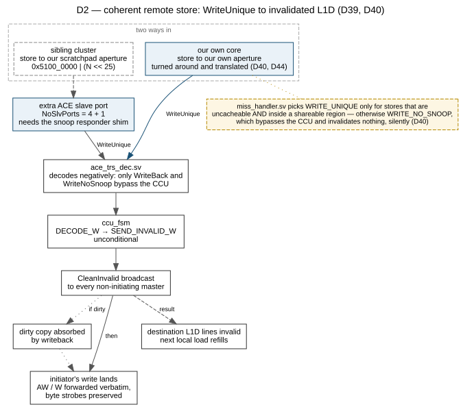
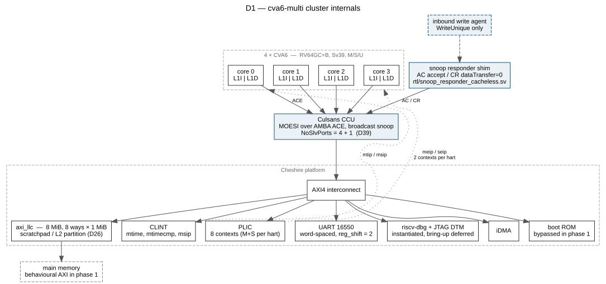
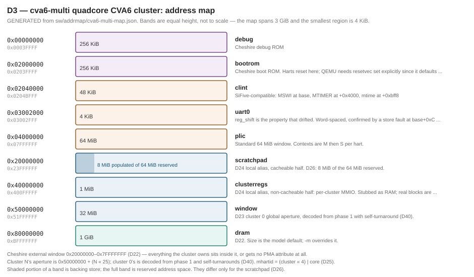

# cva6-multi — Design Decisions

**Status:** plan agreed, nothing built. Date: 2026-10-19.

Decision register for a stand-alone, cache-coherent quadcore RV64 cluster assembled from
open hardware. Gaps in the numbering are decisions not reproduced here.

---

## 1. Goal and scope

**Done means:** SMP Linux boots to a shell with all four harts online. This is chosen as a
forcing function rather than a feature — it is the cheapest test that catches integration bugs
which bare-metal tests silently tolerate. `nproc` returning 4 exercises coherence, IPIs,
per-hart PLIC contexts, the MMU, the timer and the device tree simultaneously.

**Phase 1 is Verilator only.** FPGA is a separate later phase. On FPGA the dominant work is the
DRAM controller, clocking and board plumbing, which is real but orthogonal to whether the cluster
functions. Simulation reaches a Linux shell with a behavioural AXI memory and none of it.

**In scope:** four coherent CVA6 harts, the Cheshire platform, L2, UART, interrupts, debug, boot.

**Not in scope:** multi-cluster topologies and any NoC, inter-cluster isolation or traffic
regulation, scratchpad partitioning, and any safety, redundancy or certification mechanism.
This is a single coherent cluster and nothing more.

---

## 2. Glossary

Every acronym of three or more capitals used in this document, spelled out and explained. Identifiers in code — `AWSNOOP`, `FW_FDT_PATH` — are not acronyms and are not listed. `ci/check-document.py` asserts this section covers the prose, and that every `§N` reference resolves.

### RISC-V architecture

- **RISC-V** — Reduced Instruction Set Computer, fifth Berkeley generation. The open instruction-set architecture this cluster implements.
- **RVWMO** — RISC-V Weak Memory Ordering. The architecture's memory consistency model: what orderings between loads and stores a program may rely on, and which `fence` is needed for the rest. D45 makes it the inter-cluster ordering contract.
- **ISA** — Instruction Set Architecture. The instructions and registers software may rely on; per D7 a model that advertises more than it implements kills the boot silently.
- **CSR** — Control and Status Register. The RISC-V privileged register file, reached by the `csrr`/`csrw` family.
- **AMO** — Atomic Memory Operation. A read-modify-write performed indivisibly, the basis of locks and of several coherence tests.
- **MMU** — Memory Management Unit. Translates virtual to physical addresses; this design uses Sv39, three-level, 39-bit virtual addresses.
- **TLB** — Translation Lookaside Buffer. The MMU's cache of recent translations, which must be invalidated across harts on a mapping change — the shootdown that IPIs carry.
- **PMA** — Physical Memory Attributes. Per-region properties — cacheable, idempotent, executable — that the hardware applies to an address. Cheshire derives CVA6's from a fixed set of regions, which is why D22 keeps everything inside the external window.
- **PMP** — Physical Memory Protection. The RISC-V machine-mode region permission mechanism; OpenSBI uses it to fence the firmware off from the kernel.
- **ABI** — Application Binary Interface. The calling and layout conventions a compiled object assumes; here, what a SystemC library and the simulator's own build must agree on.
- **HSM** — Hart State Management. The SBI extension by which one hart starts, stops and queries another — how harts 1 to 3 leave `wfi` in D16.
- **MUL** — The multiply pipeline of the core; named here because the carry-less multiply in it is the likely critical path on FPGA.
- **XOR** — Exclusive OR.

### Interrupts and timers

- **IRQ** — Interrupt Request.
- **MSI** — Message-Signalled Interrupt. An interrupt delivered as a memory write rather than a wire.
- **CLINT** — Core-Local Interruptor. The SiFive-originated timer and software-interrupt device: `mtime`, `mtimecmp` per hart, and `msip` for inter-processor interrupts.
- **ACLINT** — Advanced Core-Local Interruptor. The RISC-V successor to the CLINT, splitting it into separately addressable MTIMER, MSWI and SSWI devices.
- **MTIMER** — The ACLINT timer device, holding `mtime` and the per-hart `mtimecmp`.
- **MSWI** — The ACLINT machine-mode software-interrupt device, holding the per-hart `msip`.
- **SSWI** — The ACLINT supervisor-mode software-interrupt device.
- **PLIC** — Platform-Level Interrupt Controller. The original RISC-V wired-interrupt controller, with one context per hart per privilege level — eight for four harts.
- **AIA** — Advanced Interrupt Architecture. The ratified replacement for the PLIC, comprising APLIC and IMSIC. Its group-index scheme is what D23 aligns the cluster field of the address map to.
- **APLIC** — Advanced Platform-Level Interrupt Controller. The AIA's wired-interrupt half.
- **IMSIC** — Incoming Message-Signalled Interrupt Controller. The AIA's per-hart message-interrupt file, one per privilege level.
- **CLIC** — Core-Local Interrupt Controller. A RISC-V low-latency interrupt controller, not used here.

### Coherence and interconnect

- **AMBA** — Advanced Microcontroller Bus Architecture. ARM's family of on-chip interconnect protocols.
- **AXI** — Advanced eXtensible Interface. The AMBA protocol used throughout this design; independent address, data and response channels in each direction.
- **AXI4** — Version 4 of AXI, the variant used here.
- **ACE** — AXI Coherency Extensions. Adds cache coherency to AXI through three snoop channels — AC for the snoop address, CR for the response, CD for any data returned. The snoop responder shim exists because a port must answer on AC and CR even when it holds no data.
- **CCU** — Cache Coherency Unit. The block that keeps the cores' L1 data caches coherent; here the Culsans unit, adopted unmodified.
- **MESI** — Modified, Exclusive, Shared, Invalid. A classic set of cache-line coherency states.
- **MOESI** — Modified, Owned, Exclusive, Shared, Invalid. The protocol this CCU implements; the Owned state lets a dirty line be shared without writing it back first.
- **RSP** — Remote Store Programming. A model in which a core writes directly into another cluster's memory and the destination's caches are invalidated, rather than the destination polling or taking an interrupt. The primary inter-cluster programming model per D44.
- **FIFO** — First In, First Out. A queue; here usually the buffering in a flow-control path.
- **FSM** — Finite State Machine.

### Memory and caches

- **RAM** — Random-Access Memory.
- **ROM** — Read-Only Memory.
- **SRAM** — Static Random-Access Memory. On-chip memory built from flip-flop cells.
- **URAM** — UltraRAM. A larger on-chip memory primitive in recent Xilinx FPGAs, needed because the 8 MiB array exceeds the block RAM of many parts.
- **DRAM** — Dynamic Random-Access Memory. Off-chip main memory.
- **LLC** — Last-Level Cache. Here `axi_llc`, the shared L2, which also supports way-partitioning into scratchpad.
- **SPM** — Scratchpad Memory. Directly addressed on-chip memory with no cache behaviour.
- **CIE** — The attribute region of Cheshire's external window that CVA6 treats as cacheable, idempotent and executable; the split point between it and the non-cacheable remainder is what D24 places the two cluster-local aliases either side of. The exact semantics of its length parameter are an open item.
- **EXTROM** — Cheshire's external ROM region.
- **BOOTROM** — Cheshire's boot ROM region, where the harts reset.
- **IOMMU** — Input/Output Memory Management Unit. Translates and polices addresses from masters other than a core; one of the two candidate mechanisms for deciding who may write whose scratchpad (D45).
- **MMIO** — Memory-Mapped Input/Output. Device registers reached as ordinary addresses.
- **DMA** — Direct Memory Access. A engine that moves data without a core issuing each access.
- **PASW** — Physical Address Slave Window. A programmable address window, as opposed to a fixed decode rule.

### Devices and the platform

- **CPU** — Central Processing Unit.
- **CVA6** — CORE-V A6. The OpenHW Foundation's 64-bit application-class RISC-V core, six-stage pipeline, formerly Ariane. Four of them make this cluster.
- **UART** — Universal Asynchronous Receiver/Transmitter. The serial console; this one is 16550-compatible and word-spaced.
- **SPI** — Serial Peripheral Interface.
- **GPIO** — General-Purpose Input/Output.
- **VGA** — Video Graphics Array. A display interface, dropped from phase 1.
- **JTAG** — Joint Test Action Group. The IEEE 1149.1 scan interface, used here as the debug transport.
- **DTM** — Debug Transport Module. The JTAG-facing half of the RISC-V debug specification.
- **FPGA** — Field-Programmable Gate Array.
- **ECP5** — A Lattice FPGA family.
- **VCU128** — A Xilinx Virtex UltraScale+ HBM evaluation board, the part the new Culsans cluster was functionally validated on (D43). It carries URAM, which the 8 MiB array needs.
- **PULP** — Parallel Ultra-Low-Power. The ETH Zurich and University of Bologna open-hardware project, source of Cheshire, `axi_llc`, the CCU and much else here.
- **ESP** — Embedded Scalable Platforms. Columbia University's open-source SoC platform, cited as coherence precedent.

### Boot and the device tree

- **DTB** — Device Tree Blob. The compiled binary form, produced by `dtc`.
- **FDT** — Flattened Device Tree. The same blob seen from firmware; an FDT embedded in firmware overrides the pointer passed in a register, which is D37's one blind spot.
- **SMP** — Symmetric Multi-Processing. One operating-system image across all harts.
- **AMP** — Asymmetric Multi-Processing. Separate images per core or cluster.
- **RTEMS** — Real-Time Executive for Multiprocessor Systems. A real-time POSIX-compliant operating system; the new Culsans software stack supports it alongside SMP Linux (D43).

### Verification and simulation

- **RTL** — Register Transfer Level. Synthesisable hardware description — the design itself, as opposed to a model of it.
- **SVA** — SystemVerilog Assertions. Properties checked continuously during simulation; unavailable under a two-state simulator.
- **UVM** — Universal Verification Methodology. The standard class library for constrained-random, coverage-driven testbenches.
- **VIP** — Verification Intellectual Property. Bought or supplied protocol agents, checkers and coverage models.
- **UCDB** — Unified Coverage Database. The format Questa stores and merges coverage in.
- **ISS** — Instruction Set Simulator. A functional model of a core, fast but with no timing.
- **TCG** — Tiny Code Generator. QEMU's dynamic binary translator, the reason it boots Linux in seconds.
- **QEMU** — Quick Emulator. The machine emulator carrying this project's custom board.

### Modelling and virtual platforms

- **TLM** — Transaction-Level Modelling. The SystemC abstraction where a whole bus transaction is one function call rather than pin activity; TLM-2.0 is the interoperable form.
- **VCML** — Virtual Components Modeling Library. MachineWare's Apache-2.0 SystemC/TLM library of peripherals and modelling primitives.
- **AVP64** — An open ARMv8 virtual platform built on QEMU and VCML, cited as precedent for wrapping a translating core.

### Tooling, formats and organisations

- **GCC** — GNU Compiler Collection.
- **JVM** — Java Virtual Machine.
- **JSON** — JavaScript Object Notation. The format of the address-map source.
- **XML** — Extensible Markup Language.
- **YAML** — YAML Ain't Markup Language.
- **SVG** — Scalable Vector Graphics. The committed rendering of each diagram.
- **PDF** — Portable Document Format.
- **SHA** — Secure Hash Algorithm. Here, a Git commit identifier.
- **IP-XACT** — The IEEE 1685 XML format describing IP blocks and their assembly.
- **IEEE** — Institute of Electrical and Electronics Engineers. Standards body: SystemC is IEEE 1666, JTAG is 1149.1, IP-XACT is 1685.
- **ARM** — The company whose AMBA protocols this design uses.
- **MIT** — The MIT licence.
- **ETH** — Eidgenössische Technische Hochschule, Zürich. Co-author of the CVA6, Cheshire and Culsans work with the University of Bologna.

---

## 3. Decisions

### Goal and target

- **D1 — Done = SMP Linux to a shell on 4 harts.** Not `riscv-tests` passing, not bare-metal AMP.
- **D2 — Verilator first, FPGA as phase 2.** Behavioural AXI memory in phase 1. Verilator is the
  vehicle for *software* bring-up; Questa carries the verification suites Verilator cannot run at
  all (D42).
- **D3 — `NrHarts` parameterised throughout, default 4.** Cheap now; expensive to retrofit through
  the interconnect, PLIC contexts, CLINT `mtimecmp` array, debug module hart selection and the
  device tree generator. Also enables a 1-hart bring-up as an easier debug target.

### Architecture

- **D5 — Build the integration; adopt the coherence.** The SoC top, address map, AXI topology,
  peripheral wiring, interrupt routing, multi-hart debug plumbing, boot flow, device tree and
  testbench are ours. The Culsans MOESI/ACE CCU is adopted unmodified. Rationale: SoC integration
  and coherence-protocol design have wildly different cost curves — integration is tractable and
  debuggable with a clear success signal, a coherence protocol is a formal-methods problem.
  Four cores is also the top of Culsans' validated envelope, so staying at four means no
  coherence-directory work is required.
- **D6 — The integration being built is the Culsans-into-Cheshire join.** Cheshire is the platform;
  the coherent quadcore cluster is wired into it. Cheshire is single-core and Culsans is a
  multicore cluster on an older CVA6 — as far as we can determine, nobody has joined them.
- **D7 — RV64GC + Sv39 + M/S/U + Bitmanip.** No H, no V. Bitmanip arrives through the single `RVB`
  config bit, which covers Zba + Zbb + Zbc + Zbs with no finer granularity — **Zbc cannot be
  declined**, and its carry-less multiply XOR tree in the MUL pipe is the most likely source of FPGA
  timing pressure later. `ZKN` (Zbkb/Zbkx/Zkn) is available only on a current CVA6.
  - **The device tree and the hardware must agree about bitmanip, or Linux dies without a usable
    message.** Demonstrated on the virtual platform: with `zba`/`zbb`/`zbc`/`zbs` in
    `riscv,isa-extensions` but a core that does not implement them, Linux 6.18 patches in its
    Zbb-optimised `strcmp`/`strlen`/`strncmp` through `apply_boot_alternatives()` and then executes
    those instructions on a core that lacks them. The boot stops silently immediately after
    `riscv: ELF capabilities`, with no panic and no trace — the next expected line,
    `Kernel command line:`, simply never appears.
  - **This is a live risk, not a modelling curiosity.** Cheshire's default build targets a config
    package with `CVA6ConfigBExtEn = 0`, so a stock Cheshire plus a device tree written from D7
    reproduces exactly this failure. Whoever flips `CVA6ConfigBExtEn` and whoever writes the device
    tree must be the same decision.
  - Contrast with an *unimplemented CSR*, which is benign: a write to a missing `mhpmcounter` is
    ignored with a warning and the boot continues. A missing **instruction** is fatal. Advertising
    `zihpm` without the counters cost nothing; advertising `zbb` without the instructions cost the
    whole boot.
- **D8 — CLINT + PLIC.** Not AIA. See §5 for why this is not a simple swap. Reserve the IMSIC
  address ranges in the map now and leave the interconnect a spare master port for an MSI-mode
  APLIC — that is free today and converts part of any later swap from an architecture change into
  a module change.
- **D9 — Bring up on CVA6's native write-back `std_cache`; migrate to HPDcache later.** Culsans'
  ACE snoop extensions live in `std_cache` — that is the combination with a published paper behind
  it. HPDcache has no snoop support in Culsans today, so adopting it first would mean any hang has
  the integration, Culsans and an unproven cache pairing as simultaneous suspects.
- **D10 — Peripheral set:** UART, CLINT, PLIC, debug module, boot ROM, `axi_llc`, iDMA. Off in
  phase 1: VGA, I2C, SPI, GPIO, serial link, CLIC. SPI returns for FPGA SD-card boot.
- **D11 — The address map is authored to be relocatable.** Internals position-independent, upper
  bits reserved for a cluster index, holes left for apertures phase 1 does not implement. Cheap
  to decide on day one, painful to retrofit once software starts hardcoding addresses.

### Dependencies

- **D12 — Every IP dependency is pinned at an explicit commit SHA**, bumped deliberately. Not a
  tracking branch. During integration, a break caused by an upstream push destroys the ability to
  attribute a regression to one's own last change — the thing most worth protecting when the
  integration itself is the deliverable.
- **D13 — The Culsans fork this project tracks is rebased onto a current CVA6.** This is
  load-bearing: it restores `misa.B` reporting (so Spike step-and-compare works), brings the
  upstream bitmanip decoder fixes, and makes `config_pkg.sv` and `ZKN` available.

- **D43 — The Culsans line has moved on, and we follow it.** The design the earlier dependency
  decisions were derived from is upstream's 2024 snapshot. A newer cluster exists, presented at
  RISC-V Summit Europe 2026 by Bologna, STMicroelectronics, ETH Zürich, Aalto and Inria. Access to
  the RTL has been requested from its first author and is not yet held; this decision assumes it
  arrives and plans on that basis.
  - **What the new cluster is.** Three parts, all different from what §4 lists:
    - **CVA6S+** — RV64GC, six-stage, **dual-issue superscalar**, with a tournament branch
      predictor chosen by design-space exploration (−10 to −36% predictor area at equal accuracy).
    - **HPDcache extended to ACE** — a snoop handler, MOESI cacheline state tracking, a control
      pipeline reworked for snoop transactions, coherent ATOPs and LR/SC, and an AXI-to-ACE memory
      adapter giving direct cache-to-cache transfer of dirty data.
    - **A rewritten CCU** with a frontend/backend split: a pipelined point of serialisation with
      LR/SC tracking at the front, pipelined AC/CR/CD snoop handling and writebacks at the back.
  - **We track `ace/devel`, the 2026 line.** Not the 2024 master the current pin assumes. That
    decides what D12 and D13 pin and makes the CVA6 base CVA6S+ rather than CVA6.
  - **The evidence is in the branches, not the default ones.** `pulp-platform/culsans` master was
    last pushed 2024-05-04 and `pulp-platform/ace` master last committed 2024-03-24, which is where
    the "quiet upstream" reading came from. `ace/devel` was committed **2026-10-25**, and
    `ace/multicore/*` through 2026. On `devel` the CCU is `ccu_top.sv`, `ccu_frontend.sv`,
    `ccu_snoop_pipeline.sv`, **`ccu_snoop_filter.sv`**, `ccu_read_engine.sv`, `ccu_write_engine.sv`,
    `ccu_scoreboard.sv`, `ccu_exclusive_monitor.sv` and a generated `ccu_csr.sv`. **`ccu_fsm.sv` and
    `ace_trs_dec.sv` are gone**, and the old testbenches sit under `deprecated/`.
  - **What this supersedes.** D9's premise, D30's module choice, D39's whole mechanism argument and
    the component list all describe the deprecated design. They are marked rather than rewritten:
    re-deriving them needs the new RTL read, which is work and not a correction.
  - **What must be re-established when the RTL lands**, in order:
    1. **Does `WriteUnique` still invalidate every sharer?** D39's remote-store-invalidate depends
       on an unconditional broadcast. A snoop filter exists precisely so that broadcast does not
       happen, so this is the first thing to check and the one most likely to have changed.
    2. **Does the snoop responder shim still apply?** It was written against `ace_ccu_top_intf`'s
       `SNOOP_BUS.Slave snoop_ports[]` and against `ccu_fsm` waiting on `ac_ready`/`cr_valid`
       across all ports. A non-caching ACE port still needs an AC/CR responder, but that specific
       deadlock argument is gone.
    3. **Where the inbound write agent attaches**, now that port arrays and ID arithmetic have
       changed shape.
  - **A snoop filter is a move toward a directory, not away from it.** A filter invalidates only
    the caches that hold the line, which is what a directory does. It makes the remote-store path
    cheaper and narrows the gap §9 describes.
  - **Ask for the testbenches, not only the Verilog.** `ace/devel` carries no tests outside
    `deprecated/`. D18's litmus gate and the case for the Questa licences in D42 both rest on the
    four suites in the 2024 `culsans` repository. RTL without equivalents for the new line leaves
    both stranded, and the suites are the harder half to reproduce.
  - **Published results, as a baseline to measure against.** Dual-core on Cheshire, Splash-3 on SMP
    Linux: **1.80× geomean** over one core, and **1.25×** from CVA6S+ with HPDcache over CVA6 with
    the legacy write-back cache. Under 2% per-core area overhead, **35 kGE** for the CCU, no
    frequency degradation at **850 MHz** in GlobalFoundries 12nm. Functional validation on a Xilinx
    **VCU128**, which is a data point for the FPGA board question since that part carries URAM.
    The software stack covers SMP Linux and **RTEMS**.
  - **The core-count picture changes in both directions.** The design target is **2 to 8 cores**;
    what has been evaluated is **dual-core**; 4 to 8 cores is listed as future work. So "four is the
    top of the validated envelope" was wrong twice over — validated is two, and the envelope is
    eight. Four harts remains within the intended range and beyond what anyone has demonstrated.

- **D44 — Remote Store Programming is the primary inter-cluster programming model.** A cluster
  writes directly into a sibling's **scratchpad**, that scratchpad is **cacheable and coherently
  held in the destination cores' L1s**, and an inbound write invalidates the stale copies so the
  next local load refills. Inter-cluster communication is this, not shared cacheable global memory
  and not non-cacheable mailboxes.
  - **This reverses two things the map currently banks.** §9 records that the private scratchpad
    has no global aperture at all — *"no address any other cluster or external master can emit that
    reaches it"* — and D40 makes the inter-cluster target non-cacheable. Both go.
  - **The non-cacheable choice came from a constraint this project does not carry.** Extending the
    coherence domain across a cluster boundary lets a sibling's writes reach into your L1 data
    caches, which is an interference channel and a real cost where freedom from interference has to
    be argued. There is no such argument to protect here, so the constraint is available to spend.
  - **What it buys.** The consumer reads at L1 speed after one refill from local memory rather than
    at non-cacheable latency on every access. That is the whole point of the trade: the producer
    pays the store, the consumer pays one miss.
  - **The hard part is physical-address aliasing, and it must be solved for this to be correct.**
    A core reaches the scratchpad through the local alias at `0x2000_0000`, and its L1 tags that
    address. A sibling reaches the same memory through the aperture at
    `0x5000_0000 + (N << 25) + off`. Coherence is defined over physical addresses, so without
    intervention the inbound write broadcasts an invalidate for the *aperture* address, the L1
    holds the *local* address, the tags do not match, nothing is invalidated, and the core reads
    stale data with no error anywhere.
    - **This does not bite today only because the region is non-cacheable.** Nothing is cached
      under either name, so there are no stale copies to miss. Making it cacheable turns a dormant
      aliasing question into a silent correctness bug.
    - **Fix: translate at the cluster boundary.** The inbound path rewrites the aperture address to
      the local alias before the CCU sees it — one subtract — so the invalidate carries the address
      the L1 actually holds. D40 already has the boundary comparing `addr[27:25]` and servicing a
      match locally; this extends that from routing to translating, and the same rule covers
      self-turnaround.
    - **Why not the obvious alternative.** Having cores use the aperture address for their own
      scratchpad would also give one address, and would destroy D24's position-independence: the
      local alias is what lets one kernel image and one device tree run on any cluster.
  - **The aperture is re-cut**, keeping every region a naturally-aligned power-of-two block per
    D27. See §9.
  - **The non-cacheable window is dropped.** It existed because, before this decision, it was the
    only way into a cluster. It never had a defined backing store: the cluster has exactly one pool
    of on-chip SRAM, the `axi_llc` array of D26, and nothing said what part of it the window used.
    Backing it with the same bytes the cores cache would reintroduce the aliasing hazard above in a
    worse form, since the two views would differ in cacheability by design; giving it a disjoint
    partition would divide scarce SRAM to buy an optimisation nobody has measured. **One
    remote-writable region, one set of attributes.** If snoop traffic for bulk transfers later
    proves a real cost, a non-coherent partition can be added then — the aperture keeps 15 MiB
    reserved — and HPDcache ships the cache maintenance operations it would need.
  - **What it costs.** The unreachability-by-shape property, which was real safety for free. Snoop
    traffic: every inbound remote write snoops the destination's L1s, which is affordable at four
    cores and is the argument for the directory-based path at sixteen. And verification nobody has
    — Culsans' litmus and unit suites are single-cluster, so D18's gate needs extending rather than
    porting.
  - **Depends on D43.** The mechanism has to be re-established against the new CCU before this can
    be built. A snoop filter makes it cheaper, not harder.

- **D45 — RSP alignment reviewed: four of four on the classic properties, two architectural gaps
  that the property list does not cover.** D44 makes the model the architecture; this is what that
  costs and what it still leaves open.
  - **What holds.** Remote stores land in the destination's own SRAM; the consumer reads locally at
    cache speed after one invalidation and refill; and there is **no inter-cluster coherence
    protocol** — the destination's own CCU does the invalidating, triggered by an ordinary inbound
    `WriteUnique`, so coherence stops at the cluster boundary.
    Notification has a path already in the map: the aperture's 1 MiB MMIO region is the global alias
    of the IMSIC/APLIC pages, so a sibling can raise an MSI. And polling a *cacheable* flag that the
    producer's write invalidates is cheap, where polling the old non-cacheable window burned fabric
    bandwidth on every iteration.
  - **Decision: a read of a sibling's aperture takes an error response.** RSP's latency argument
    assumes stores only, and the aperture is otherwise readable, so a remote load would be correct
    and silently slow. D40 already chose error responses for absent clusters on the loud-failure
    principle; this is the same principle applied to the same boundary. A remote load in an RSP
    program is nearly always a bug, and the alternative is a performance mystery.
  - **Decision: the ordering contract is RVWMO, not a bespoke completion protocol.** Making the
    aperture cacheable and coherent (D44) has a consequence worth stating plainly: the inter-cluster
    channel is now **ordinary memory**, not a device region with its own rules. So the software
    contract for the classic write-payload-then-set-flag pattern is the ordinary one — `fence w,w`
    at the producer, a `fence r,r` or a data dependency at the consumer — and the hardware
    obligation is that the whole path honours RVWMO across a cluster boundary.
    - **Rejected: relying on the interconnect to preserve point-to-point order**, or on the producer
      waiting for the ACE write response before issuing the flag. The first assumes a property of a
      NoC that does not exist yet; the second serialises and throws away the fire-and-forget
      behaviour that makes RSP fast. Neither is needed if the region is genuinely memory.
    - **Not free: it propagates a requirement to the NoC.** Whatever fabric joins the clusters must
      not reorder in a way that breaks RVWMO between a producer and a destination. That constraint
      belongs in the NoC's requirements from the start, because discovering it afterwards is the
      expensive order.
  - **Who may write whose scratchpad is settled by D46: a stray remote store must be prevented.**
    Before D44, unreachability-by-shape meant no cluster could touch another's — safety as a
    property of the map, spent by D44 with nothing in its place. PMP does not fill it: PMP gates a
    hart's *own* accesses, not inbound ones.
  - **Open: allocation.** Who owns which part of a destination's 8 MiB is a software contract and
    needs stating before two teams write to the same offsets.
  - **Consequence for D18: the litmus gate moves.** The ordering decision above makes the memory
    model load-bearing at precisely the place D18 does not look — its suite, and Culsans', are
    single-cluster. D18 therefore **extends to two clusters** rather than porting, and the
    cross-cluster litmus tests are ours to write. This is the largest piece of work D44 creates.
  - **Scaling, briefly.** Every inbound remote write snoops every L1 in the destination cluster.
    Affordable at four cores and the reason eight needs care; the snoop filter on the D43 line
    improves it materially, which is the same convergence toward a
    directory noted above.

- **D46 — A stray remote store from one cluster must be *prevented*, not merely debugged.** The
  inbound path is checked, and a store from a cluster not permitted to write a region is rejected
  before it reaches the coherence domain.
  - **This is not a security-only question, and "we run one Linux" is not a reason to skip it.**
    The inbound path is architecturally **DMA**: an inbound write carries a physical address and
    passes through no core's MMU and no PMP, because both of those gate a hart's own accesses. So
    even with a single SMP Linux spanning every cluster — emphatically not several tenants — a
    buggy driver on one cluster can scribble on another's physical memory, exactly as a
    misprogrammed DMA engine can. Mixed-criticality needs the check for a second reason, with no
    adversary anywhere: freedom from interference has to be *argued*, not assumed.
  - **Where: at the cluster boundary, in the same block that performs D44's translation**, and
    **upstream of the CCU**. The last part is the requirement that matters — a rejected write must
    never enter the coherence domain, or a denied store still snoops and still invalidates, which
    is an interference channel in its own right.
  - **Mechanism still open**, and the choice is genuinely balanced:
    - **A per-cluster inbound permission register.** Cheap, and the new CCU's CSR block
      (`ccu_csr.sv`, D43) is a precedent for where it would live. Granularity is coarse — source
      cluster against address range — which is likely enough for RSP, where the unit of sharing is
      a buffer rather than a page.
    - **An IOMMU on the inbound path.** Standard, far heavier, page-granular, and already
      committed to by the reconvergence target; VCML models one (`riscv/iommu.h`, D36).
  - **Two requirements this creates, both easy to miss:**
    1. **The source cluster identity must be unforgeable.** A check is worthless if a cluster can
      claim to be another, so the fabric must attach the source id where the transaction enters and
      must not let the payload set it. This joins RVWMO (D45) as a requirement the NoC has to carry
      from the start rather than acquire later.
    2. **Violation reporting belongs at the destination, not only at the source.** RSP is
      fire-and-forget: the producer may have retired the store long before any response arrives, so
      an error on the ACE write response is necessary and not sufficient. The destination must log
      the rejected access and be able to raise an interrupt — otherwise a prevented write is also
      an invisible one, and a misconfigured permission looks exactly like a software bug.
  - **Honest about what is lost.** §9 originally justified the scratchpad's unreachability as *"a
    property of the map's shape rather than a permission check that could be misconfigured"*. This
    is precisely the permission check that sentence contrasted against. A check is strictly weaker
    than a map that cannot express the access at all, and it is weaker in the specific way that
    sentence named. The capability D44 wanted is not available without accepting that.

### Boot and debug

- **D15 — Preload a single OpenSBI `fw_payload.elf`** (OpenSBI + kernel + DTB + initramfs) into the
  behavioural memory at reset. No boot ROM path, no SPI/SD model, no U-Boot, no filesystem in
  phase 1.
  - **Two constraints the one-line form hides**, both of which bite at build time rather than at
    boot time:
    - **`fw_payload` takes exactly one payload.** `FW_PAYLOAD_PATH` is a single file, so "kernel +
      initramfs" means the initramfs is linked *into* the kernel via `CONFIG_INITRAMFS_SOURCE`,
      not appended as a second blob. The Buildroot configuration has to produce that `Image`.
    - **The device tree comes in through `FW_FDT_PATH`, and it is then the only one the system
      sees** — there is no `a1` pointer to fall back on, because nothing else places a DTB. Per
      D37 that path must be `sw/cva6-multi.dtb` itself, never a copy, and the firmware is rebuilt
      whenever the map changes. This is the one consumer `gen.py --check` cannot police.
  - Note the offsets already agree: `FW_PAYLOAD_OFFSET` defaults to `0x20_0000`, which against the
    `0x8000_0000` firmware base is the `0x8020_0000` kernel address the map already carries.
- **D16 — Hart 0 boots; harts 1–3 park in `wfi` awaiting OpenSBI HSM start.** Letting the other
  three free-run into the kernel produces corruption that looks random and is painful to diagnose.
  **The boot hart is not hart 0 by default** — observed on QEMU `virt` booting on hartid 3 in one
  configuration and hartid 0 in another, from identical images. Whichever hart arrives first wins
  unless something constrains it, so this is a platform obligation, not an assumption.
- **D17 — Instantiate the RISC-V debug module and JTAG DTM from the start; defer bring-up to FPGA.**
  Instantiating is nearly free and avoids re-plumbing hart selection later (another `NrHarts`
  consumer). Driving it under Verilator means modelling JTAG transport and running OpenOCD against
  the simulation — slow, and rarely worth it against full waveform visibility.

### Verification

- **D18 — Litmus tests on RTL are a gate before the first SMP Linux attempt.** A coherence bug found
  by Linux hanging is close to undiagnosable: the symptom appears thousands of instructions after
  the violating interleaving, in kernel code nobody here wrote, on four harts at once. The same bug
  found by a litmus test is a ten-line repro with an exact failing interleaving.
  - **The suite exists and we do not write it (D42).** Culsans ships `tests/litmus/`,
    which builds RISC-V litmus tests with the `diy`/litmus7 generator, runs them on the RTL and
    compares outcomes against **herd7**'s expected set through `create_exp.py`. The remaining work
    is porting it to this cluster — Cheshire platform, our map, the extra slave port — which is a
    much smaller job than building a litmus flow, and a different one. It is Questa-only: the
    Makefile drives `vsim` against a `vopt`-produced `_optimized` top and there is no Verilator
    harness, so without a Questa licence this gate is not reachable at any price in effort.
- **D19 — Three verification layers before Linux:** `riscv-tests` for the single-hart baseline,
  Spike step-and-compare for per-hart divergence, litmus for coherence.
  - **D42 adds a fourth below them**: Culsans' own unit suite, roughly 35 tests of which a third
    are constrained-random. It sits below `riscv-tests` because it exercises the coherence unit
    directly rather than through an instruction stream, and it is the layer that would catch a
    D39 regression.
- **D20 — Four milestones, each a working system.** See §6.

### Environment

- **D21 — Tooling is provisioned reproducibly** (nix or equivalent) and declared in-repo, so the
  environment is shared rather than reconstructed per machine. QEMU is included deliberately:
  validating the OpenSBI/kernel/initramfs stack there before subjecting it to Verilator avoids
  debugging software bugs at RTL simulation speed.

### Address map and decode

- **D22 — Everything the cluster owns lives inside Cheshire's external window
  `[0x2000_0000, 0x8000_0000)`.** Not a preference: Cheshire derives CVA6's PMA attributes in
  `gen_cva6_cfg()` from only EXTROM, BOOTROM, SPM, SPM_UNC, the LLC-out region, and the CIE/non-CIE
  split of that window. A region outside it gets **no** cacheability, executability or idempotency
  attribute from any rule. Carfield confirms this empirically — every one of its islands sits inside
  the same window.
- **D23 — The cluster ID is the AIA group index, `E = 25`, at `addr[27:25]`.** Cluster *N*'s global
  aperture base is `0x5000_0000 + (N << 25)`, 32 MiB each. The AIA group-index scheme
  (`(g << E) | A | (h << C)`, `riscv,group-index-shift` default 24, up to 7 group bits) is the only
  ratified RISC-V convention placing a cluster ID in a physical-address bit field, and its alignment
  rules on `A` exist specifically so `+` can be implemented as bitwise `|`. The spec names the use
  case directly: *"each group exists on a separate chip (or chiplet in a multi-chip module)."*
- **D24 — Two cluster-local aliases, one either side of the CIE split.** Cheshire provides exactly
  one CIE split point in the external window, so the cacheable alias (scratchpad, `0x2000_0000`) sits
  below it and the non-cacheable alias (per-cluster MMIO, `0x4000_0000`) above it, via
  `Cva6ExtCieOnTop = 0` and `Cva6ExtCieLength = 0x0400_0000`. Both stay position-independent, which is
  what lets one kernel image and device tree run on any cluster unchanged. Precedent: Snitch's
  `alias_region_enable` gives every internal subordinate two crossbar rules, one cluster-specific and
  one at a fixed cluster-independent base — and with it enabled `boot_addr` becomes unused, because
  every cluster boots from its own alias address.
- **D25 — `mhartid = (cluster_id << HartIdShift) | core_index`, with `HartIdShift = 4`.** Four bits
  for the core field, not two: the coherence unit caps the cluster at four cores today, but a
  directory-based successor would allow up to sixteen, and a two-bit field forecloses it. Phase 1 is
  unaffected, since cluster 0 gives harts 0–3 under either width. This is also the decomposition the
  AIA uses — APLIC computes `g = (HartIndex >> LHXW) & (2^HHXW−1)` and `h = HartIndex & (2^LHXW−1)`
  with `LHXW = HartIdShift` — so the hart id, the AIA hart index and the cluster field of the address
  are one encoding. **`HartIdShift`, `riscv,hart-index-bits`, and the IMSIC reservation size are the
  same number**, and the reservation is the one that is cheap to oversize now, so the map reserves the
  sixteen-core geometry. Sparse hart ids are safe: Linux stores them as opaque values in
  `cpuid_to_hartid_map[]` with no density requirement, OpenSBI indexes through `hart_index2id`, and
  Carfield ships sparse ids under both. Note OpenSBI's `SBI_HARTMASK_MAX_BITS` defaults to 128, which
  8 x 16 harts exactly fills.

- **D26 — An 8 MiB `axi_llc` array in 8 ways of 1 MiB, partitionable up to 7 MiB scratchpad and
  1 MiB L2.** `axi_llc` partitions by way and selects SPM ways through a config register, so eight
  1 MiB ways give 1 MiB partition granularity with "at least one way stays cache" as the floor.
  Phase 1 configures 1 way scratchpad and 7 ways L2 — nothing consumes the scratchpad yet, but one
  SPM way exercises the way-partitioning path and the local-alias decode against a real region.
  Sizing: 1 MiB per way at 64-bit data width means `NumLines × NumBlocks = 131072`, e.g. 64-byte
  lines and `NumLines = 16384`. Note this is **64× Cheshire's default SPM** of 128 KiB.
  The cluster gets its own `axi_llc` and Cheshire's is kept as a platform LLC: Cheshire's instance
  sits in front of DRAM at a fixed address in the static region, which is the wrong slot for a
  per-cluster L2 and private scratchpad behind the CCU. That leaves two non-coherent layers below the
  CCU, so the window region must lie outside the cached range of **both** — `axi_llc` decides what to
  cache by address range rather than by AXI cache attributes, making this a configuration property.
  Note also that the SPM cached region's nominal size in `cheshire.rdl` is 64 KiB while its real
  backing is `get_llc_size(cfg)`; routing is correct but generated constants understate it. Free under
  Verilator; a serious constraint on FPGA, where it exceeds the total block RAM of many parts.
- **D27 — Structural decode inside and at the cluster boundary; programmable windows only at
  platform level.** Cluster-local aliases and cluster-ID routing are fixed structural decode —
  programmability there buys nothing and introduces a way for one cluster to differ from another.
  Base-and-size programmable windows (the PASW pattern, as found on various SoCs) are the right
  answer for DRAM extent and any PCIe or flash aperture, because those are boot-time discoveries.
  Consequence now: **every platform-level region is a single naturally-aligned power-of-two block**,
  so it can be converted to a window later without moving anything.
- **D28 — Write our own elaboration assertions.** `cheshire_soc.sv` lines 1783–1796 are all TODO
  comments; nothing checks external region overlap, legality, or consistency with the CVA6 PMA
  config. Assert on overlap, CIE boundary alignment, and aperture alignment against the AIA
  constraint.
- **D29 — Pin the Cheshire configuration and assert on `ext_base`.** External crossbar ports occupy
  the top indices after all *enabled* internal ports, so toggling `Dma` or `SerialLink` silently
  renumbers them. The caps are 15 external AXI subordinates and 15 rules.
- **D30 — Culsans' SoC top level is discarded; only the CCU and the coherent CVA6 wrapper are
  taken.** `culsans_top.sv` ships a full SoC with its own hardcoded CLINT at `0x0200_0000` and PLIC at
  `0x0C00_0000` that would collide with Cheshire's. D6 integrates `ace_ccu_top_intf`, not the Culsans
  platform.

- **D40 — Phase 1 decodes cluster 0's own global aperture and self-turnarounds.**
  The `0x5000_0000`–`0x5FFF_FFFF` rule exists from the first cluster, and the boundary compares
  `addr[27:25]` against its own cluster ID and services a match locally rather than leaving the
  range unimplemented. The decode-rules table in §9 already assumed this, and both virtual
  platforms have been booting against a map that models it, so this ratifies the state of the work
  rather than adding to it.
  - **Why: a decode path first exercised when cluster 1 appears is debugged under the worst
    conditions available.** Its first exercise would otherwise coincide with the first NoC bring-up,
    the first cross-cluster coherence traffic and the first multi-cluster interrupt routing — all of
    which produce the same symptom, a store that does not land. Phase 1 is where that path is cheap
    to debug because nothing around it is new.
  - **Why: it makes the coherent-remote-store programming model testable on one cluster.** Per D39
    `ccu_fsm` goes `DECODE_W → SEND_INVALID_W` unconditionally and broadcasts `CleanInvalid` to
    every *non-initiating* master. So core 0 storing to its own cluster's window, turned around
    locally, invalidates cores 1–3's L1D copies: the full semantics, one cluster, phase 1.
    **This does not test the snoop responder shim** — in self-turnaround the initiator is a core on
    an existing slave port, and the shim only sees traffic when the initiator is the added port. The
    shim still needs its own integration test with a write agent, as D39 records.
  - **Why: it tests the property convergence depends on.** D24's point is that one kernel image and
    one device tree run on any cluster unchanged, and self-turnaround is what makes "a cluster's own
    aperture" resolve uniformly. Exercising it on one cluster is a cheap test of the mechanism the
    whole convergence story rests on.
  - **The argument against, which is real.** An unimplemented range fails loudly; a decoded one
    fails quietly. With the aperture decoded, software that uses the global alias where it should
    use the cluster-local alias **still works** in phase 1 — slower and non-cacheable, but correct —
    and then behaves differently once the NoC is real. Left unimplemented, that bug is a decode
    error on first execution. Accepted, and mitigated outside the decode: the two aliases already
    differ in cacheability, and the virtual platforms should assert when private data is reached
    through the global alias. That recovers most of the strictness without deferring the decode.
  - **Three sub-decisions this forces, which must not stay implicit:**
    1. **The window is non-cacheable *and* shareable.** Not a detail: `miss_handler.sv` selects
       `WRITE_UNIQUE` only for stores that are uncacheable *but inside a shareable region*, and
       `WRITE_NO_SNOOP` otherwise. `WriteNoSnoop` bypasses the CCU entirely and invalidates nothing,
       so without the shareable attribute the loopback above degrades silently — the store still
       lands, and nothing announces that no invalidation happened. The cost of shareable is that
       every core store to the window enters the CCU and broadcasts an invalidate, which is the
       intended semantics rather than a side effect.
    2. **An access to clusters 1–7's apertures in phase 1 takes an error response**, not a silent
       drop. This is the loud-failure principle applied where it costs nothing: in phase 1 those
       addresses can only be reached by mistake.
    3. **The turnaround is serviced at the boundary, not looped out and back through the inbound
       write port.** Looping is tempting because it would exercise the shim too, but a request loop
       through one boundary can deadlock when outbound and inbound share buffering, and the shim has
       its own test. Rejected on that basis rather than overlooked.
  - **Dependency worth naming:** the window inherits non-cacheable from sitting outside the CIE
    region, which holds only if `Cva6ExtCieLength = 0x0400_0000` means what D24 assumes. That
    semantic is still unconfirmed, so this decision is coupled to it.
### Scope of this repository

- **D31 — This repository is documentation only, permanently.** The implementation depends on IP
  hosted where an external reader cannot reach it, so nothing here could ever be built from a public
  clone, no matter how it were arranged. Rather than publish something that looks buildable and is
  not, the public copy carries the design record alone: the decisions, the address map, the AIA
  survey, the component list and the milestones, each of which stands on its own. There is no RTL
  here and no Bender manifest, and there will not be.

### Virtual platform

- **D35 — The virtual platform is staged, and functional only.** Three vehicles, each with a
  different job:
  1. **QEMU `virt`** for the half of the software stack that does not depend on our map — kernel
     config, initramfs, the HSM multi-hart boot path, and D7's ISA as advertised in a device tree.
     Done: `sw/qemu-virt-check.sh`, 4/4 + 5/5 + 13/13.
  2. **Renode** for **our** map. Done: `sw/renode-check.sh`, 14/14 — OpenSBI 1.6 and Linux 6.18.7
     boot on the D22-D25 map with four harts online. Chosen because `.repl` platform descriptions
     are declarative, so a custom address map costs tens of lines rather than hundreds of lines of C.
  3. **A QEMU machine** for daily software work, when boot time starts to hurt. Not started. The
     shortcut is Ben Dooks' CVA6 machine series (v4, September 2025, reviewed but never merged):
     a working CVA6 + CLINT + PLIC + 16550 machine whose memmap table can be swapped for ours.
  - **Both vehicles are dynamic binary translators.** Renode's `CPU.RiscV64` is a C# wrapper over
    `translate-riscv64-le.so`, its tlib engine, which is derived from QEMU's TCG. Instruction
    semantics are modelled; pipeline, caches, bus arbitration and timing are not. `cpuType:
    "rv64gc_zba_zbb_zbc_zbs"` selects decode paths and is the *only* respect in which the core
    resembles CVA6 — no HPDcache, no `std_cache`, no ACE port, no coherence unit at all.
  - **Therefore it validates the map, the device tree and the software, and nothing about the
    hardware.** A functional model that boots cleanly while the RTL has an ordering bug is the
    expected outcome. D18's litmus gate stays on RTL.
- **D36 — Renode hosting Verilated RTL is the candidate bridge to phase 1.** Renode ships a
  `CoSimulationPlugin`, and the idiom extends to the **CPU**, not only peripherals: Verilator
  compiles the RTL into a shared library and Renode loads it in place of a tlib core. Their
  `verilated_ibex.resc` shows it as one line — `cpu SimulationFilePathLinux <libVcpu_ibex.so>`.
  - **Why it is attractive.** The cluster could be Verilated as the CPU complex while Renode keeps
    supplying the peripherals and the address map that already boots. That is an incremental route
    from a validated map to real RTL, without first building a complete Verilator testbench and
    peripheral set — which is otherwise the long pole in D2's phase 1.
  - **Why it is a candidate and not a decision.** It needs the RTL to exist, so it is gated on the
    Culsans pin (D12, D13). It competes with a plain Verilator testbench, which has no C# in the
    loop. And the published example is Ibex, a small RV32 core: a four-hart coherent RV64 cluster is
    a far larger Verilated object, so throughput collapses toward plain Verilator and the hosting
    buys less.
  - **It does not relax D18.** Verilating the cluster inside Renode still leaves the surrounding
    model non-architectural about memory ordering, so litmus evidence must come from a flow where
    the whole path is RTL.
  - **VCML is the stronger SystemC route, and probably the better bridge overall.**
    [machineware-gmbh/vcml](https://github.com/machineware-gmbh/vcml) is an Apache-2.0 SystemC/TLM-2.0
    modelling library, actively maintained — pushed 2026-10-20, 205 stars, one open issue, CI across
    Linux, Windows and macOS with ASan, lint and coverage. That is a different standard of upkeep
    from the other SystemC options surveyed.
    - **Its RISC-V peripheral set reads like a shopping list for this project**: `models/riscv/`
      carries `clint.h` and `aclint.h` and `plic.h` for D8 today, `aplic.h` for the AIA
      reconvergence path, and an `iommu.h` for later. The surrounding platform would
      be largely off the shelf rather than written.
    - **Verilator emits SystemC modules natively** (`verilator --sc`), so a SystemC platform is the
      natural host for Verilated RTL — more natural than Renode's C# `CoSimulationPlugin`. That is
      still why VCML displaces Renode for this step.
    - **Verilation is not the only way to get RTL into the platform, nor the best one.** Questa
      co-simulates SystemC/TLM with SystemVerilog RTL in one kernel, so the RTL need not be
      Verilated at all — and Verilating it would *discard* the four-state simulation and live SVA
      that D42 is about. The two routes are not the same thing at different speeds; they are
      different fidelity classes, and D42's ladder places them.
    - **It also gives the missing-CPU problem a fourth answer: the real CVA6 RTL.** The three
      recorded below are `spike-vp`, a commercial ISS, and a Verilated core. Under Questa the core
      can simply *be* the design, with VCML supplying peripherals over TLM — no ISS at all, highest
      fidelity, slowest. It is also the natural shape for D19's tandem check, with Spike on the
      other side.
    - **It also supplies timing annotation**, which is wanted here rather than feared: D26's
      scratchpad-versus-L2 split and the window sizing both lack any basis, and a model that can
      produce numbers is the only way to put one under them.
    - **There is an open-source RISC-V CPU route, and it is Spike.** The library itself contains
      no CPU — `core/processor.h` is abstract, `virtual void simulate(size_t) = 0` — but
      MachineWare's curated community list carries **`spike-vp`**, Apache-2.0, "a VP built around
      the Spike RISC-V simulator… fast enough to run Linux with an interactive command line". The
      gap is therefore **narrow, though not closed**:
      - Its own README calls it **"a proof of concept"**; last pushed **February 2024**.
      - It builds against **three personal forks** — of VCML, of SystemC 2.3.3, and of
        `riscv-isa-sim` on a `spike-for-systemc` branch. Upstream Spike does **not** work as a VCML
        processor as-is; the fork *is* the integration.
      - So adopting it means taking a stale proof of concept with a patched Spike, or redoing the
        integration against current upstreams. Neither is a drop-in, but both are far cheaper than
        a commercial licence.
      - Sibling precedent: **AVP64** (MIT) is an ARM multi-core VCML platform built on **QEMU**,
        running Xen and Linux — so wrapping a translating core rather than an interpreter is an
        established pattern here. A QEMU-based RISC-V VCML platform looks plausible and simply does
        not exist yet.
    - **D35's objection to Spike serving both the virtual platform and D19's tandem verification
      does not apply to this arrangement.** That objection is about Spike's *platform* being crude
      — compile-time `#define` addresses, a minimal device set — not about its core. With VCML supplying the peripherals, Spike need only be the ISA, which is what
      it is best at: **one ISS, two jobs**, with the crude half replaced. The speed cost is real
      though — Spike runs roughly 10 to 30 times slower than QEMU TCG, so this is a
      fidelity-and-structure platform, not the one to iterate software on daily.
    - **The 16550 is there, and so is the right variant.** The filenames in `models/serial/`
      name other devices (`sifive`, `pl011`, `cdns`, `uartlite`, `nrf51`), but
      `models/serial/uart.h` declares a `uart` base plus three variants, and the third is the one
      this cluster needs:

      | model | `REG_SIZE` | FIFOs | matches |
      | --- | --- | --- | --- |
      | `vcml::serial::uart8250` | 1 | 1 | byte-spaced 8250 |
      | `vcml::serial::uart16550` | 1 | 16 | byte-spaced 16550 |
      | `vcml::serial::uart16550x32` | **4** | 16 | **ours**, `reg_shift = 2` |

      So the peripheral set is complete and the only remaining hole is the core. The three-way
      choice is an instance of the D37 trap in an unusually inviting form — `uart16550` is the
      obvious name and the wrong model — which is why the generator emits the model name rather
      than leaving it to be remembered.
    - **One gap remains besides the core.** VCML is a library, not a platform, so the VP is
      assembled rather than configured. And `aplic.h` ships without an `imsic.h`, so its AIA
      support covers direct delivery only.
    - **Open before this becomes load-bearing:** MachineWare's licensing. The library is Apache-2.0
      but they advertise a separate "VCML community" offering, which usually signals a dual-licence
      arrangement worth understanding before depending on it.
    - **Not a replacement for either working vehicle.** Renode boots the map at 14/14 and the QEMU
      machine at 15/15 in under 10 s. Assembling a VP from a library and sourcing a core, to reach a
      capability already in hand, is not the trade for this repository's purposes. What makes it
      worth building anyway is the next bullet.
  - **The SystemC platform is owned outside this repository**, by people with prior working
    experience of VCML — which is the single largest piece of de-risking available to this route,
    since "assembled rather than configured" is a cost that falls on someone who has assembled one
    before. Three consequences:
    - **The address map must not fork.** D37 exists because the same numbers lived by hand in four
      places and drifted. A SystemC platform is a fifth consumer with the same traps available, so
      `sw/addrmap/gen.py` now emits a VCML header and a VCML property file from the same JSON
      source, and a cross-check asserts the VCML and QEMU views still describe one machine using
      only a C++ compiler — no VCML or SystemC install needed, so it runs anywhere
      `gen.py --check` runs. The property **keys** follow the avp64 convention and are a proposal to
      be renamed; the **values** are the contract.
    - **The timing discipline stops being structural.** D35 notes that all three current vehicles
      are functional only and produce no timing at all. A timing-annotated VP removes that property.
      Here that is wanted — D26's partition and the window sizing have no basis — but it means any
      downstream consumer that must not take sizing numbers from a model can no longer rely on the
      platform being incapable of producing them. That reverts to a rule people follow rather than
      one the tooling enforces.
    - **It is a cross-team dependency**, structurally like the tracked Culsans fork (D12, D13):
      owned elsewhere, consumed here, and needing its interface pinned rather than assumed. The map
      is pinned as of this decision; the CPU choice, the SystemC version and the platform's module
      hierarchy are not.
  - Renode's co-simulation covers the CPU, not only peripherals, which is what makes it a
    candidate bridge at all.

- **D37 — The address map has one machine-readable source, and every view is generated from it.**
  `sw/addrmap/cva6-multi-map.json` is authoritative; `sw/addrmap/gen.py` emits the device tree, the
  Renode platform, the QEMU board's memmap header and the VCML/SystemC platform's address map
  (D36). `gen.py --check` prints a diff and fails if
  any generated file is stale, which belongs in CI next to the strip-list grep (D34).
  - **It exists because the map drifted and the drift was expensive.** The same map lived by hand in
    four places: prose, the device tree, the Renode platform and a C table. The device tree declared
    `reg-shift = <2>` on the UART while the QEMU model was byte-spaced. The failing access was a
    store fault at `base+0xC`; under Renode the same mismatch produced only warnings, so the louder
    model found it and the quieter one hid it.
  - **A generated view can carry a model choice, not only numbers.** Where a map property determines
    which model is correct, the generator emits the model name too: `reg_shift = 2` selects
    `vcml::serial::uart16550x32` over the identically-named-but-byte-spaced `uart16550`, as a macro
    the platform declares its member through. That converts an agreement that has to be remembered
    into one the compiler holds. It is the same property that drifted in the first place.
  - **Properties belong in the source, not just addresses.** `reg_shift`, the 1 MHz timebase, the
    PLIC's source count and contexts-per-hart, the UART IRQ, and the ISA extension list are all
    things two consumers must agree on, and each is now stated once. The bitmanip list matters most:
    per D7, a model that does not implement what the tree advertises dies silently.
  - **Reserved span and populated size are distinct fields.** `size` is address space, `populated`
    is backing store, and they differ for the scratchpad: 8 MiB of array inside 64 MiB reserved
    (D26). Consumers that instantiate memory use `populated`; the device tree's `reserved-memory`
    node uses it too.
  - **Stdlib only, JSON not YAML.** No pyyaml here and Python is 3.10 with no `tomllib`. A generator
    that needs a dependency installed is a generator that will not run on the machine that needs it.
  - **One consumer the gate cannot police: a device tree embedded in firmware.** `gen.py --check`
    asserts that the committed `.dts` and `.dtb` match the JSON. It cannot assert that the
    *firmware* was built against that `.dtb` rather than a copy of it, and on OpenSBI's generic
    platform an embedded FDT **overrides the pointer passed in `a1`**. So a firmware built with
    `FW_FDT_PATH` silently replaces the generated device tree with whatever was baked in at
    firmware build time, and the failure is the D7 class — it boots, then something disagrees
    subtly, a long way from the cause.
    - **Rule: any `FW_FDT_PATH` points at `sw/cva6-multi.dtb`, never at a copy**, and the firmware
      is rebuilt whenever the map changes. A copy is a fifth hand-maintained device tree with the
      gate looking the other way.
    - **D15 already commits to exactly this packaging**, so the rule is a requirement of an
      existing decision rather than a precaution against a hypothetical one. Under `fw_payload`
      there is no pointer in `a1` to override, because nothing else places a device tree: the
      embedded FDT *is* the mechanism, and it is the only copy the system sees.
    - Not a problem in the **current QEMU flow**, and checked rather than assumed: neither
      `fw_jump.bin` nor `fw_dynamic.bin` contains the `d00dfeed` magic, Buildroot sets no
      `FW_FDT_PATH`, and the QEMU board deliberately refuses to synthesise a device tree — most
      RISC-V machines build one in `machine_init`, which would itself have been a second source.
      The DTB reaches OpenSBI in `a1` from the boot ROM, and the check script's first assertions
      read our own `model` string back out of it.
    - The `fw_payload.elf` sitting in the OpenSBI build tree today is **not** D15's image: it
      carries no FDT, and its `.payload` is OpenSBI's 8520-byte built-in test payload rather than
      our 27 MiB `Image`, because neither `FW_PAYLOAD_PATH` nor `FW_FDT_PATH` is set. It is a
      build by-product Buildroot does not even copy to `images/`. D15's image has to be built
      deliberately, and that build is where this rule applies.
  - **This is the lightweight precursor to D38's heavier flows**, not a competitor to them. It owns
    addresses and cross-consumer properties. It does not describe structure, connectivity or register
    fields, and is not trying to.
- **D38 — SystemRDL when the first register block is ours; IP-XACT when RTL assembly starts.**
  Neither yet, and the order matters.
  - **SystemRDL via PeakRDL, at the first self-defined register block.** Cheshire is already
    PeakRDL-based: its map lives in a generated `cheshire_addrmap_pkg.sv` built from `cheshire.rdl`.
    So the choice is not whether to adopt SystemRDL but whether to align with the platform's existing
    flow or maintain something parallel to it. The trigger has not arrived: every register block in
    D10's peripheral set belongs to adopted IP, and ours are all still reserved address space — the
    iDMA config, the cluster `axi_llc` config, and the QoS/regulator registers inside the
    `0x4000_0000` alias. Extend `cheshire.rdl`'s conventions rather than starting a second flow.
    PeakRDL is not installed; it is a one-line nix addition when wanted.
  - **IP-XACT at D6, not before.** IEEE 1685 describes structure and connectivity for IP
    integration, and its value appears when assembling real IP with real interfaces — which is
    exactly the Culsans-into-Cheshire join, and that work has not started. Ten regions and four harts
    do not need it; the ceremony would exceed the content. Adoption cost here is unusually low, given existing in-house IEEE 1685-2022 modelling of a comparable topology.

- **D41 — Diagrams are Graphviz text, rendered to committed SVG and PDF, and checked.**
  `docs/diagrams/*.dot` with `build-diagrams.sh` from the shared docbuild package; the address-map
  figure is generated by `gen.py` instead of drawn. `docs/diagrams/README.md` is the how-to.
  - **The decisive reason is that this repository is a reviewed derivative of a private one**, and
    what may be published is gated by searching the files for forbidden terms. That search skips
    binary files, so a compressed editor format — DrawIO's default `.drawio` is base64-deflated
    XML — would pass untouched. A diagram can carry a confidential name as easily as a paragraph
    can. DrawIO can be saved as plain XML, but that is a per-file setting and one forgotten
    checkbox is a leak; even then its text sits in entity-encoded attributes, so multi-word terms
    would be split across markup and fail to match. Ruled out on that basis, not on taste.
  - **Graphviz over the other text formats**, in descending order of weight:
    - **One small C dependency**, already present. No Node, no JVM, no headless browser, nothing
      fetched at build time. Mermaid's renderer wants Puppeteer and a Chrome download, which
      contradicts both docbuild's no-network design and D37's rule that a generator needing an
      install is a generator that will not run on the machine that needs it.
    - **Its output already fits `svg2pptx.py`.** With `node [shape=box]` a Graphviz SVG uses only
      `g`, `path`, `polygon`, `text` and `title`, so figures reach PowerPoint as editable shapes.
      Verified rather than assumed; the default `<ellipse>` node does *not* fit, which is why the
      renderer validates its own output and fails with the fix named.
    - **Automatic layout.** Hand-authored SVG is good source and reads well, but every edit means
      recomputing coordinates, which is what stops diagrams being kept current.
  - **Where the other tools still win, and are allowed.** Mermaid renders natively on GitHub,
    which is where this plan is read, so it is the right choice for a diagram that lives inline in
    Markdown and never needs to reach the PDF — a protocol sequence most of all, which is the one
    shape Graphviz is bad at. TikZ is right for a PDF-only figure needing exact typography, and
    costs no new dependency since xelatex is already required.
  - **The address map is generated, not drawn.** Hand-drawn it would be another copy of numbers
    that already have one source, and the one nobody re-checks — the drift D37 exists to stop, in
    a file no staleness gate covers. `gen.py` emits it as SVG in the same subset, so it is checked
    by `gen.py --check` like every other view.
  - **Both renderings are committed, which needs a reason.** Four consumers want a rendered
    figure and only one can run Graphviz: the beamer deck embeds vector art, `build-pptx.sh`
    redraws native shapes, the Markdown PDF includes it, and GitHub displays it. The PDF rendering
    exists because pandoc cannot place an SVG without `rsvg-convert` and **fails the whole
    document** rather than dropping the figure; `render.sh` swaps the link in the PDF path only.
    `--check` is what keeps a committed build product honest.
  - **The committed PDFs are the one thing this does not solve.** The term search skips them
    exactly as it would skip a compressed editor file. They are covered *transitively* — each is
    derived from a text source that is searched, and `--check` asserts the two still agree — but
    that is an argument, not a search, so the gate lists every binary file it could not read.
  - **A diagram that disagrees with the record is worse than none**, because it looks
    authoritative. Each source names the decisions it depicts, so a change to those decisions
    should send the reader here.

- **D42 — Questa 2026.3 is the verification simulator; Verilator stays the software-bring-up
  simulator.** Verilator boots software at a speed Questa cannot approach on a four-core coherent
  cluster; Questa runs the suites Verilator cannot run at all.
  - **The shape is a fidelity ladder, not a split between two simulators.** Questa also
    co-simulates SystemC and TLM-2.0 alongside SystemVerilog RTL in one kernel, so it can host the
    platform model as well as the design, and the same platform model serves three of the four
    rungs:

    | rung | what runs | speed | fidelity |
    | --- | --- | --- | --- |
    | 1 | VCML alone, no RTL | fastest | functional only (D35) |
    | 2 | VCML + Verilated RTL | fast | two-state, synthesisable subset, no SVA |
    | 3 | VCML + **real RTL** under Questa | slow | four-state, full SystemVerilog, SVA live, RTL unmodified |
    | 4 | pure RTL under Questa | slowest | the upstream suites and litmus |

  - **Rung 3 is what makes the virtual platform checkable against the design.** D35 records the
    platform as functional-only, and nothing anywhere validates the *model* against the *hardware*.
    Replacing one TLM peripheral at a time with its RTL in the same run, and confirming the
    platform still behaves identically, turns a plausible model into a checked one. It also gives
    the externally-owned platform work a verification story it did not have.
  - **It de-risks the cross-team dependency too.** Rungs 1 to 3 share one platform model, so if the
    Verilator bridge disappoints, the platform still has somewhere to run.
  - **What rung 3 needs that we do not have.** A **TLM-2.0 ↔ AXI4/ACE transactor**: VCML speaks the
    TLM generic payload and the cluster boundary is pins. Vendor AMBA transactors are normally part
    of separately-licensed VIP, the same open question as the ACE protocol checker below; writing
    one is possible, but handshake and ordering bugs in a transactor produce exactly the confusing
    failures the tool was adopted to avoid. Then `sccom` and ABI matching — checked rather than
    assumed, VCML asks for `find_package(SystemC "2.3.0")` and `cxx_std_17`, so unlike `spike-vp`
    it is **not pinned to a fork** and should build against Questa's bundled SystemC. That is build
    integration, not research.
  - **The largest consequence is that two of Culsans' four verification suites are otherwise
    unreachable:**

    | suite | what it is | Verilator harness |
    | --- | --- | --- |
    | `tests/unit/` | ~35 tests, around a third constrained-random | **none** — Questa only |
    | `tests/litmus/` | litmus7-generated, herd7 as the oracle | **none** — Questa only |
    | `tests/integration/` | ~19: AMO mutex, spin locks, writeback/evict/flush | `culsans_tb.cpp` |
    | `tests/performance/` | ~27 latency tests, hit/shared/remote × busy × snoop | `culsans_tb.cpp` |

  - **It de-risks D39 more than anything else available.** Widening `NoSlvPorts` to 5 and
    attaching the shim is the change most likely to break the coherence unit subtly rather than
    loudly, and there is now an upstream regression to run before and after. More generally it is
    what D12 and D13 were missing: a tracked fork you cannot regression-test is a tracked fork you
    are guessing about.
  - **Constrained-random becomes possible at all.** Verilator has no class randomisation, no
    constraint solver and no covergroups; the unit suite has `TB_AXI_RAND_DELAY` and
    `ENABLE_ICACHE_RANDOM_GEN`, and `tests/common.mk` already merges UCDB coverage with `vcover`.
    For a MOESI broadcast coherence unit this is the distinction that matters: directed tests find
    the bugs someone thought of, random stimulus finds the interleavings. The snoop shim is
    exactly such a block — its plausible failure is back-pressure *timing*, and
    `tb_snoop_responder_cacheless.sv` walks the encodings deterministically.
  - **Four-state simulation.** Verilator is two-state, so X-propagation is invisible: reset
    bring-up and uninitialised SRAM are the bug class it hides and FPGA then exposes. Concretely
    for the shim, the negedge drive-and-sample convention that testbench uses to avoid races can
    be replaced by SVA and an explicit X check rather than a scheduling trick.
  - **It gives the window sizing its first real basis.** §9 records that sizing has none. The
    performance suite measures read and write latency across hit, shared and remote cases with and
    without snoop contention, on the RTL. Incomplete — there is no NoC in it — but cycle data
    rather than a guess, and it bears on D26's partition too.
  - **What it does not change.** Nothing in D35 or D36: the virtual platforms are unaffected, and
    `verilator --sc` remains what emits SystemC for the co-simulation bridge. It does not help the
    8 MiB FPGA-fit risk. And it does not displace Verilator for booting Linux, which is ~10⁸
    cycles.
  - **The existing gates stay licence-free.** A licensed simulator needs a licence server, so it
    cannot run in public CI. The map, diagram and strip-list gates deliberately need only Python,
    Graphviz and a C++ compiler; Questa regressions are a separate and heavier tier, not something
    to fold into them.
  - **First friction to expect:** `tests/common.mk` expects `SPIKE_ROOT=/opt/riscv-isa-sim`,
    `RISCV=/opt/riscv` and a `riscv64-unknown-elf-` prefix, where the Linux toolchain here is
    `riscv64-buildroot-linux-gnu-` and the bare-metal one is listed as missing in §8.
  - **Four concurrent licences**, which is a planning input rather than a footnote. The upstream
    suites are roughly 35 unit, 27 performance and 19 integration tests plus litmus, so four-way
    parallelism decides what can be enforced per merge request versus what runs nightly. Three
    consequences:
    - **Run a smoke subset per merge request and the full suite nightly.** A regression that cannot
      finish between pushes stops being run either side of every change to the coherence unit,
      which was the point of having it (D39).
    - **Litmus is iteration-hungry by construction and will dominate.** herd7 gives the *allowed*
      outcomes; the RTL run has to sample enough executions for the absence of a forbidden one to
      mean anything. On RTL each execution is expensive, so the iteration count is a deliberate
      choice bounded by seats — not a default to discover after the fact. State the number the
      evidence rests on whenever a litmus result is quoted.
    - **Compile and simulate may draw from the same pool.** `vlog`, `vopt` and `vsim` can each
      check out, so a parallel `make -j` can consume all four before a single simulation starts,
      and a full-tilt regression leaves nobody able to debug interactively. Reserve a seat rather
      than discovering this during a bring-up.
  - **Open, and worth answering before planning around it:** which tier carries what. Core, Prime
    and One have historically differed on coverage, UVM performance and debug, and Culsans' flow
    depends on `vcover` and UCDB merging. Separately, AMBA protocol-checker VIP is usually licensed
    apart from the simulator — an ACE checker bound to the new slave port would be the cheapest
    insurance available for D39, so whether it is included is worth establishing.

### Remote store programming

- **D39 — Coherent remote stores are reachable as an integration, not a coherence-unit
  modification. D5 stands.** Established from the RTL: the Culsans CCU already performs
  remote-store-invalidate for `WriteUnique`, and the path is exercised rather than dead code.
  - **The mechanism.** `ace_trs_dec.sv` decodes *negatively* — the only writes bypassing the CCU are
    `WriteBack` and `WriteNoSnoop`, so **everything else on AW enters it**, `WriteUnique` and
    `WriteLineUnique` included. `ccu_fsm` then goes `DECODE_W → SEND_INVALID_W` unconditionally,
    broadcasting `CleanInvalid` to every non-initiating master, absorbing any dirty copy via a
    writeback, and only then landing the initiator's write with AW/W forwarded verbatim — so byte
    strobes and sub-cacheline sizes survive, and the ordering is correct.
  - **CVA6 already emits it**: `miss_handler.sv` selects `WRITE_UNIQUE` for stores that are
    uncacheable but inside a shareable region.
  - **The integration cost.** Set `NoSlvPorts = cores + 1` and attach the inbound-write agent to the
    extra port. The CCU's slave-port and snoop-port arrays share one index space and `ccu_fsm` waits
    on `ac_ready != '1` / `cr_valid != '1` across all ports, so the new port needs a **trivial AC/CR
    snoop responder** — accept every AC, answer CR with `dataTransfer=0` — or the FSM deadlocks on
    the first shareable transaction from any core. There is no ACE-Lite port type in either CCU
    generation, and no precedent: every known integration sets slave ports equal to the core count.
    Adding a port also widens IDs downstream, since `ccu_fsm` recovers the initiator index from an ID
    prefix sized `$clog2(NoMstPorts)`.
  - **This is invalidation, which is what comparable designs do.** A cluster-level directory-based
    coherence unit sending invalidation messages to the L1Ds on an in-domain store is the established
    shape of this capability; the version here reaches the same semantics by **broadcast snoop**
    rather than by a directory. The difference is scalability, not behaviour: broadcast costs a snoop
    to every cache on every in-domain store, which is why four cores is the validated envelope, while
    a directory invalidates only the caches holding the line. So the directory-CCU path that would
    raise the cluster toward sixteen cores (D25) converges on that established structure, and the
    broadcast form is its small-scale version.
  - Either way the destination takes a miss and refills from its own L2 or scratchpad rather than
    across the fabric, which preserves the store-latency-for-load-latency trade.
  - **The snoop responder shim, concretely.** The added port needs an ACE snoop (AC/CR) responder,
    because the slave-port and snoop-port arrays share one index space and `ccu_fsm` waits on
    `ac_ready != '1` and `cr_valid != '1` across every port. The agent has no cache, so the correct
    answer to every snoop is "I do not hold this line", unconditionally:
    - **AC**: hold `ac_ready` asserted and accept every snoop type without decoding it. CVA6's own
      responder recognises only `CleanInvalid`, `ReadShared`, `ReadOnce` and `ReadUnique`; a cacheless
      port has no reason to distinguish them.
    - **CR**: for each accepted AC return one `cr_valid` with an all-zero response — no data
      transfer, no error, not shared, not passing dirty, not previously unique. Take the exact field
      names from the snoop package rather than from this description.
    - **CD**: never driven, since `dataTransfer = 0` means no cache-data beats follow.
    - **Depth**: one outstanding snoop suffices if AC is accepted only while no CR is pending;
      otherwise the AC-to-CR path needs a small FIFO. Either way it is a few tens of lines.
    - Tie off `rack`/`wack`, which `ACE_BUS` carries but `ccu_fsm` does not use.
    The shim is not specific to remote stores — it is what **any** non-caching master needs to sit on
    this CCU — so it is worth writing as a reusable module rather than inline.
  - **Do not upgrade to the newer CCU expecting better.** The `devel` generation is a pipelined
    rewrite with a real snoop filter and a more complete ACE package, yet `ace_is_write_unique` is
    **never called** in it — a `WriteUnique` would reach memory un-snooped. Its AR path does decode
    `CleanInvalid` and `MakeInvalid`, and it carries a `hasUntrackedArId` field documented as "a port
    without a snoopable cache", so on that generation the viable shape is write plus an explicit
    AR-channel invalidate.
  - **Three latent hazards in the shipped CCU**, dormant only because CVA6 never emits the offending
    transactions, and live the moment a new master appears. **`Evict` would hang it** — not exempted
    by the decoder, so it enters the write path and waits for W beats that never come.
    `WriteLineUnique` gets `CleanInvalid` where the specification says `MakeInvalid`, costing a
    needless writeback. `WriteClean` and `WriteEvict` also take the invalidate-then-write path, wrong
    for `WriteClean`. A new agent must emit `WriteUnique` and nothing else.
  - **Consequence for D9: HPDcache has no coherence at all** — no AC/CR channel, no snoop responder,
    no shared/exclusive state — and evicts clean lines **silently**, so an external snoop filter in
    front of it is permanently conservative. The HPDcache migration would lose this capability as
    described. Its alternative hook is `mem_resp_read_inval_i`, a working external cacheline-
    invalidation input built for OpenPiton's L15 and currently hard-tied to zero on the AXI path with
    the comment *"AXI NoC doesn't support invalidations"*. That is in-band invalidation rather than
    ACE snooping, and its fan-out, back-pressure and refill-FIFO sizing are unsolved.
  - **No prior art.** No open-source RISC-V design implements remote store programming, and none does
    ACE IO-coherent DMA. The nearest precedents use other protocols: Rocket Chip's TileLink probes,
    ESP's MESI directory with ACE used only for L1 invalidation, and OpenPiton's L15 in-band
    invalidations. PULP's shared-L1 clusters sidestep it by making L1 a scratchpad, not a cache.

---

## 4. Component list

| Component | Source | Role | Notes |
| --- | --- | --- | --- |
| CVA6 ×4 | OpenHW Foundation | RV64GC + B, Sv39, M/S/U | Via a Culsans-compatible fork |
| L1I + L1D `std_cache` | CVA6 native | Private per hart | Write-back; ACE snoop lives here |
| Culsans CCU | pulp-platform | MOESI over AMBA ACE, broadcast snoop | Unmodified; 4 cores is the top of its validated envelope |
| Cheshire | pulp-platform | Platform, boot, peripherals | The SoC skeleton |
| `axi_llc` | pulp-platform, via Cheshire | L2 | Supports way-partitioning into scratchpad |
| CLINT | via Cheshire | `mtime`/`mtimecmp` per hart, `msip` IPIs | IPIs carry TLB shootdown and scheduler wakeups |
| PLIC | via Cheshire | External interrupts | 2 contexts per hart (M + S) = 8 contexts |
| `riscv-dbg` + JTAG DTM | via Cheshire | Debug | Instantiated, bring-up deferred |
| UART | via Cheshire | Console | |
| Boot ROM | via Cheshire | Zero-stage | Bypassed in phase 1 |
| iDMA | via Cheshire | DMA | |
| AXI4 interconnect | Cheshire | Fabric | |
| Behavioural AXI memory | Testbench | Main memory, phase 1 | Replaced by a DRAM controller in phase 2 |

Software: OpenSBI (≥ v1.0, generic platform), Linux ≥ 6.10, Buildroot or equivalent initramfs.

---

## 5. Why not AIA

AIA (APLIC + IMSIC) is the better interrupt architecture and its software support is mature. It is
nonetheless out of scope here, for reasons that are about RTL availability rather than preference.
Findings as of 2026-10-19:

- **Mainline CVA6 has no AIA at all.** Not partial — absent. No `miselect`/`mireg`, no
  `mtopei`/`stopei`, no `mtopi`/`stopi`, and no config parameter. The core's entire interrupt
  interface is `irq_i[1:0]`, `ipi_i`, `time_irq_i`, `debug_req_i` — a PLIC/CLINT contract.
- An IMSIC is architecturally **part of the hart**, reached through CSRs, not a bus peripheral.
  Without those CSRs the core physically cannot reach an IMSIC's interrupt files.
- The only CVA6 with AIA CSRs is the Zero-Day Labs research fork: **single-hart**, reaching its
  IMSIC through a bespoke non-standard sideband bundle, last touched January 2025, never proposed
  upstream.
- The AIA RTL itself (`zero-day-labs/riscv-aia`) carries its authors' own warning that it is
  "not formally verified" and "very likely to have bugs", with roughly one commit in the last 20
  months. The only alternative, `jhauser-us/jh_APLIC`, ships no IMSIC.
- **No multicore CVA6 running SMP Linux on AIA appears to exist publicly** — not in a paper, repo
  or thesis that we could find.

The software side is ready: Linux merged the APLIC and IMSIC drivers in **6.10** (July 2024) and
has maintained them since; OpenSBI has had AIA since v1.0 and enables it in the generic defconfig.
The bottleneck is entirely RTL.

Gotcha for anyone attempting it: OpenSBI detects Smaia by *reading* `mtopi`. On a CVA6 without it
the read traps, OpenSBI silently concludes "no AIA", and the failure presents as a confusing
fall-through rather than an error.

---

## 6. Bring-up milestones

Each stage isolates one new failure class. Going straight to four harts means every bug has every
possible cause.

1. **One hart, bare-metal** — `riscv-tests` passing. Validates the Cheshire integration, the address
   map and the toolchain.
2. **One hart, Linux to a shell** — adds MMU, traps, peripherals, boot flow, device tree.
3. **Two harts, SMP** — the first stage where coherence and IPIs matter at all. Litmus gate (D18)
   precedes this.
4. **Four harts, SMP** — scale. The D1 success condition.

**Packaging changes at stage 1 — see D15**, which preloads a single `fw_payload.elf`. The device
tree moves inside the firmware image there, which is D37's one blind spot: the stage to apply that
rule, not the stage to discover it.

**Open risk:** Culsans may not support a single-core configuration. It is a coherency unit built
for 2–4 cores and `NrHarts=1` may be untested or structurally unsupported. If so, stages 1 and 2
run on bare CVA6 without Culsans — still worth doing, since they validate the Cheshire integration
and address map independently, but the Culsans join then first gets exercised at stage 3.

---

## 7. Risks

**The CVA6 version triangle — the hardest practical problem in D6.** Three pins must become one:

| Consumer | Pins |
| --- | --- |
| Cheshire | `pulp-platform/cva6` at `pulp-v2.0.0` (2025-07-17) |
| Culsans | `planvtech/cva6` at `culsans_pulp` (`338d4c1e`, 2024-03-24) |
| This project | A current CVA6 (D13) |

Reconciling these is likely the bulk of the Culsans-into-Cheshire work. Note also that Cheshire's
default build targets a config package with `CVA6ConfigBExtEn = 0`, so **bitmanip is compiled out
of a stock Cheshire** — D7 requires explicitly turning it on.

**Other risks:**

- **HPDcache + Culsans has never been built.** Culsans' snoop extensions are in `std_cache`;
  HPDcache appears nowhere in the Culsans repo. Making that pairing work is a project, not a
  config switch.
- **Culsans upstream is dormant** — last public push 2024-05-04, with an unanswered
  "Some files are missing" issue open since March 2025.
- **Phase 2 has no board selected.** A quadcore CVA6 running Linux needs a large Xilinx or Altera
  part and the corresponding vendor toolchain; open flows (yosys/nextpnr targeting
  ECP5/iCE40/MachXO2/Nexus/Gowin) will not hold it.

---

## 8. Required tooling

| Tool | For |
| --- | --- |
| `qemu-system-riscv64` >= 11.1 | The generic `virt` pre-flight and the custom board (D35) |
| `dtc` | Compiling the generated device tree (D37) |
| Renode >= 1.17 | The declarative platform (D35) |
| Linux-target RISC-V toolchain | Kernel and userspace; Buildroot builds its own |
| Verilator >= 5 | D2 phase 1, and D36's co-simulation. Verilator 4.x is too old for current CVA6 flows |
| Spike | Tandem verification (D19) |
| `openocd` | Phase 2 debug bring-up |
| `bender` | Resolving Cheshire and Culsans dependencies. No distro package and no cargo toolchain by default |
| RISC-V GCC >= 12 | `riscv-tests` and bare-metal stages. GCC 11 and earlier reject the ratified `zba`/`zbb`/`zbs` names, which D7 makes a hard floor |
| PeakRDL | SystemRDL register blocks, when D38's trigger arrives |
| Questa 2026.3, 4 concurrent | D42: Culsans' unit, litmus, integration and performance suites; D18's gate; D39's regression. Needs a licence server, so not public CI |
| `diy` / litmus7 and herd7 | D18 via D42. Culsans' `tests/litmus` builds the tests, but the generator and the oracle are separate |

Device tree note: the single `riscv,isa` string is deprecated in favour of `riscv,isa-base` plus a
`riscv,isa-extensions` array. Linux will not enable its Zbb-optimised string routines or report the
extensions through `hwprobe` unless the DT advertises them. Emit both forms.

---

## 9. Address map

Physical address width: CVA6's `PLEN` is **56** for RV64 and is not configurable (a pure function of
`XLEN`). Cheshire truncates to `AddrWidth`, default **48**. The map needs 31 bits, so neither binds.

| Range | Size | Class |
| --- | --- | --- |
| `0x0000_0000`–`0x1FFF_FFFF` | 512 MiB | **Cheshire, static.** Boot ROM, CLINT `0x0204_0000`, PLIC `0x0400_0000`, UART `0x0300_2000`, SPM, debug ROM. Generated from `cheshire.rdl` via PeakRDL into `cheshire_addrmap_pkg.sv` |
| `0x2000_0000`–`0x23FF_FFFF` | 64 MiB | **Local alias, cacheable (CIE).** Scratchpad, 8 MiB array. Identical in every cluster |
| `0x2400_0000`–`0x3FFF_FFFF` | 448 MiB | Reserved |
| `0x4000_0000`–`0x41FF_FFFF` | 32 MiB | **Local alias, non-cacheable.** Per-cluster MMIO. Identical in every cluster |
| `0x4200_0000`–`0x4FFF_FFFF` | 222 MiB | Reserved |
| `0x5000_0000`–`0x5FFF_FFFF` | 8 × 32 MiB | **Per-cluster global apertures.** Cluster *N* at `0x5000_0000 + (N << 25)` |
| `0x6000_0000`–`0x7FFF_FFFF` | 512 MiB | Reserved |
| `0x8000_0000`–… | configurable | DRAM, via `LlcOutRegionStart`/`LlcOutRegionEnd` (default 2 GiB) |

### Inside the non-cacheable local alias (`0x4000_0000`, 32 MiB)

| Address | Size | Region | Phase 1 |
| --- | --- | --- | --- |
| `0x4000_0000` | 64 KiB | Per-cluster ACLINT reserve (MTIMER/MSWI/SSWI) | reserved — phase 1 uses Cheshire's platform CLINT |
| `0x4001_0000` | 64 KiB | IMSIC M-mode files, up to 16 × 4 KiB, aligned `0x10000` | reserved — D8 |
| `0x4002_0000` | 64 KiB | IMSIC S-mode files, up to 16 × 4 KiB, aligned `0x10000` | reserved — D8 |
| `0x4004_0000` | 32 KiB | APLIC (16 KiB minimum in MSI mode) | reserved — D8 |
| `0x4010_0000` | 1 MiB | iDMA configuration | ✓ |
| `0x4020_0000` | 1 MiB | `axi_llc` configuration / way partitioning | ✓ |
| `0x4030_0000` | 1 MiB | Quality-of-service / regulator registers | reserved |
| `0x4040_0000` | 28 MiB | Reserved | |

IMSIC geometry, sized for a sixteen-core ceiling rather than today's four: `riscv,hart-index-bits = 4`
at that ceiling and 2 while the cluster holds four cores, no virtualisation, one group per cluster,
`riscv,guest-index-bits = 0`, `riscv,group-index-bits = 3`, `riscv,group-index-shift = 25`. M-mode and
S-mode files are in separate regions — the AIA says "should" rather than "must", with the reason that
a single PMP entry can then grant supervisor access to all supervisor-level files, but the Linux
device-tree binding requires one IMSIC node per privilege level, making it de facto mandatory.

### Inside a per-cluster global aperture (32 MiB)

| Offset | Size | Region |
| --- | --- | --- |
| `+0x000_0000` | 1 MiB | Externally-visible per-cluster MMIO — global alias of the IMSIC/APLIC pages |
| `+0x010_0000` | 15 MiB | Reserved |
| `+0x100_0000` | 8 MiB | **Scratchpad aperture — cacheable and shareable. The RSP target, and the only remote-writable region (D44)** |
| `+0x180_0000` | 8 MiB | Reserved — where a non-coherent bulk partition would go if one is ever justified |

Every region is a naturally-aligned power-of-two block, per D27.

**The scratchpad is reachable from other clusters, and that is the point (D44).** An earlier shape
gave it no global aperture at all, which was real safety for free; RSP as the primary programming
model requires a sibling to be able to write into it, so the property is spent deliberately.

**The aperture address is not the address the caches hold.** Cores reach the scratchpad through the
local alias at `0x2000_0000`; siblings reach it at `+0x100_0000` inside this aperture. The cluster
boundary **translates the aperture address to the local alias** before the CCU sees the transaction,
so an inbound write invalidates lines the L1s actually hold. Without that translation the invalidate
carries an address no cache has tagged, nothing is invalidated, and the destination reads stale data
silently. One subtract at the boundary; see D44.

**Self-window turnaround** falls out of D23: a cluster reaching its own window uses the global address
for its own ID, and the boundary compares `addr[27:25]` against its own cluster ID and services the
access locally instead of emitting it. Same mechanism, no special case. **Present from phase 1 per
D40**, serviced at the boundary rather than looped through the inbound write port, and
**translating to the local alias** for the scratchpad aperture per D44. The aperture is
**shareable**, which is what puts it in the coherence domain; outside one, `miss_handler.sv` picks
`WRITE_NO_SNOOP`, which bypasses the CCU and invalidates nothing.

### Decode rules required

| | Rules | External AXI subordinate ports |
| --- | --- | --- |
| One cluster | 3 | 1 |
| Eight clusters | 3 | 2 |

Two local-alias rules plus one rule covering `0x5000_0000`–`0x5FFF_FFFF`, with self-turnaround decided
inside the cluster boundary. **Additional clusters cost no additional rules.**

### Open

- `Cva6ExtCieLength` semantics: whether it is measured from the external window base, and what CIE
  actually asserts.
- Window region sizing, and the 8 MiB array, both need checking against a chosen FPGA part's
  on-chip memory; and the 1 MiB way granularity against `axi_llc`'s legal configurations.
  Window sizing now has a route to a real number (D42): Culsans' performance suite measures read
  and write latency across hit, shared and remote cases under snoop contention, on the RTL. With
  no NoC in it, that bounds the cluster-local half of the question only.
